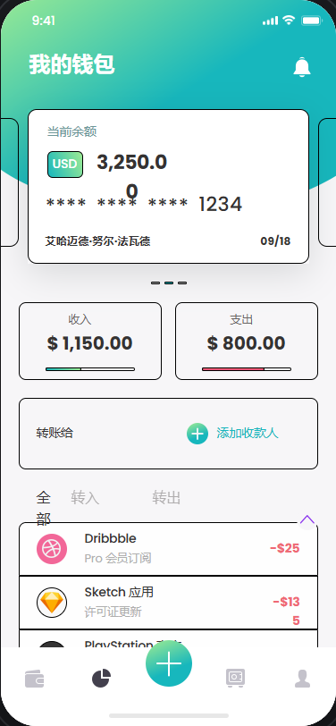
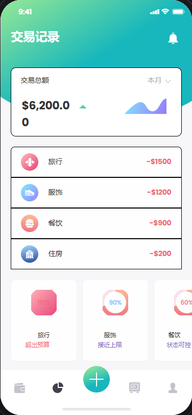
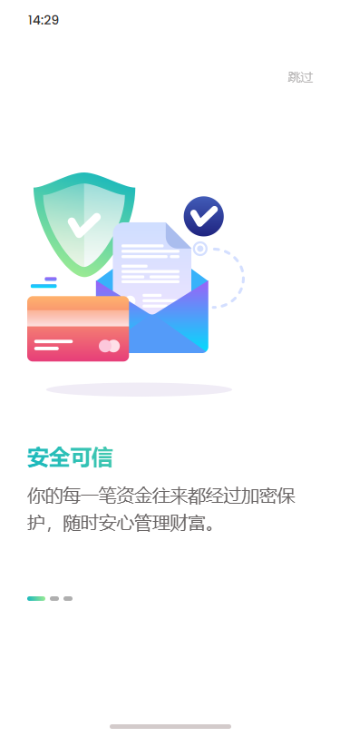
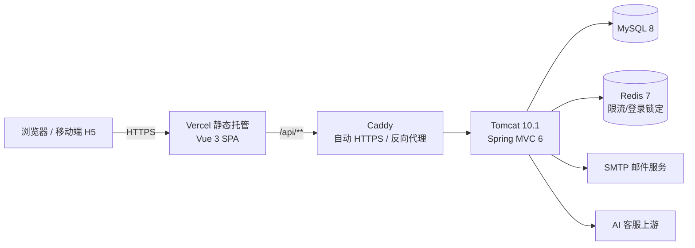
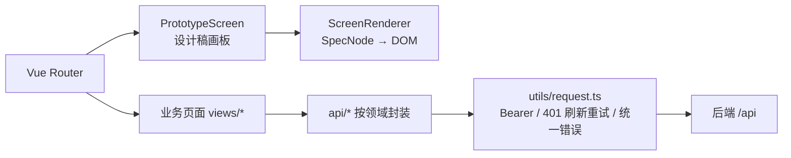

# Kaya Wallet · 移动端钱包全栈项目

一个按设计稿 1:1 还原的移动端数字钱包：Vue 3 前端 + 传统 Spring MVC 后端 + MySQL，覆盖注册登录、钱包余额、记账、转账、银行卡、预算、通知、回单下载与 AI 客服。

> 前端不是逐页手写，而是有一套**设计稿 JSON 驱动的渲染引擎**；后端刻意不使用 Spring Boot，用传统 `web.xml` + Jetty/Tomcat WAR 的方式落地。





## 技术栈

| 层 | 选型 |
| --- | --- |
| 前端 | Vue 3.5 · TypeScript 5.7 · Vite 6 · Pinia · Vue Router · Element Plus · Axios · Sass |
| 后端 | JDK 17 · Spring MVC 6.1 · Spring Security 6 · MyBatis 3.5 · PageHelper · HikariCP |
| 数据 | MySQL 8（13 张表）· Redis 7（限流，可选降级为单机内存） |
| 认证 | JWT HS256（Access + Refresh 双令牌）· BCrypt(12) · Refresh Token Rotation |
| 工程化 | GitHub Actions · Docker Compose · Caddy（自动 HTTPS）· k6 · JUnit 5 + Mockito |
| 文档 | OpenAPI 3.0.3 · Apifox · Mermaid 架构图 |

## 架构



前端内部数据流：



后端严格分层：`controller → service → mapper（MyBatis XML） → MySQL`，SQL 全部收敛在 `resources/mapper/*.xml`，分页统一 `PageHelper + PageResult`。

## 核心能力

### 认证与安全

- Access Token + Refresh Token 双令牌；刷新令牌只存 SHA-256 哈希，且每次刷新都轮换（rotation），并发重放只有第一个请求成功
- 登录失败对不存在的邮箱也执行一次 BCrypt 校验，抹平响应时间差，避免账号枚举
- 密码重置令牌一次性消费、过期失效；重置后吊销全部会话
- 证件号等敏感字段落库前加密（`security.field-encryption-key`），接口只返回后 4 位
- 登录失败锁定与接口限流：Redis 固定窗口计数，Redis 不可用时自动退化为单机内存

### 资金一致性

- 所有资金变动接口强制 `Idempotency-Key`（8–64 位），数据库唯一索引兜底，同键重放返回首次结果
- 钱包扣款使用 `balance + version` 乐观锁，更新影响行数为 0 时返回冲突而不是覆盖
- 余额、月度收支、预算使用率、回单均为流水派生数据，不单独存储，避免双写不一致
- 金额全链路 `DECIMAL(18,2)` + 字符串传输，规避 JS 精度问题

### 前端

- 设计稿 JSON → `ScreenRenderer` 绝对定位渲染，23 个画板可直接对照设计稿验收
- Axios 封装统一拆解 `{ code, message, requestId, data }`，401 时自动刷新令牌并重放原请求，刷新失败才清理登录态
- 路由守卫区分 `requiresAuth` / `guestOnly`，登录态存 Pinia + localStorage
- 移动端 375×812 设计基准，适配安全区；桌面宽度显示画板侧栏便于验收

### 其它

- 统一错误码 → HTTP 状态映射，`X-Request-Id` 贯穿请求头与响应体，便于日志排查
- 交易回单 PDF 由后端自行生成，不依赖第三方 PDF 库
- AI 客服代理统一收口上游密钥与上下文长度，带超时、重试与限流提示

## 目录结构

```
.
├── app/                       # 前端
│   ├── src/
│   │   ├── api/               # 按领域拆分的接口封装
│   │   ├── components/        # 通用组件（状态栏、底部导航、页面骨架）
│   │   ├── prototype/         # 设计稿 JSON 渲染引擎 + 23 个画板
│   │   ├── router/            # 路由与守卫
│   │   ├── stores/            # Pinia
│   │   ├── utils/             # axios 封装、token 存取
│   │   └── views/             # 34 个业务页面
│   ├── db/                    # MySQL DDL + 种子数据
│   └── docs/                  # 接口设计、数据库设计、OpenAPI
├── kaya-backend/              # 后端（Maven WAR）
│   └── src/main/java/com/kaya/
│       ├── config/            # 数据源、MyBatis、Security、Web
│       ├── common/            # 统一响应、异常、RequestId、分页
│       ├── controller/        # 15+ REST 控制器
│       ├── service/           # 业务与实现
│       ├── mapper/            # MyBatis 接口
│       ├── security/          # JWT、字段加密
│       └── storage/           # 头像存储
├── deploy/                    # Dockerfile、Caddyfile、部署说明
├── perf/                      # k6 压测脚本
└── .github/workflows/ci.yml   # CI
```

## 快速开始

### 方式一：本地开发

依赖：Node 20+、JDK 17+、Maven 3.9+、MySQL 8。

```bash
# 1. 初始化数据库
mysql -u root -p -e "CREATE DATABASE kaya DEFAULT CHARACTER SET utf8mb4 COLLATE utf8mb4_0900_ai_ci;"
mysql -u root -p kaya < app/db/schema.sql
mysql -u root -p kaya < app/db/seed.sql

# 2. 后端配置（该文件不入库）
cp kaya-backend/src/main/resources/application.properties.example \
   kaya-backend/src/main/resources/application.properties
# 修改 jdbc.password、mail.*、jwt.secret 等

# 3. 启动后端：http://localhost:8080/api
cd kaya-backend && mvn jetty:run

# 4. 启动前端：http://localhost:5173
cd app && npm install && npm run dev
```

前端 Vite 将 `/api` 代理到 `http://localhost:8080`，无 rewrite，因此后端上下文固定为 `/api`。

### 方式二：Docker Compose 一键启动

```bash
cp deploy/.env.example deploy/.env   # 填写数据库密码、JWT_SECRET、SMTP
docker compose --env-file deploy/.env up -d --build
# API: http://localhost/api/health
# 接口文档: http://localhost/swagger.html
```

## 配置项

敏感配置全部通过环境变量覆盖（Spring `SystemEnvironmentPropertySource` 自动映射 `jdbc.url → JDBC_URL`）：

| 变量 | 说明 |
| --- | --- |
| `JDBC_URL` / `JDBC_USERNAME` / `JDBC_PASSWORD` | 数据库连接 |
| `JWT_SECRET` | HS256 密钥，≥ 32 字节 |
| `SECURITY_FIELD_ENCRYPTION_KEY` | 敏感字段加密密钥，≥ 32 字节 |
| `MAIL_HOST` / `MAIL_PORT` / `MAIL_USERNAME` / `MAIL_PASSWORD` / `MAIL_FROM` | SMTP |
| `REDIS_URL` | 例如 `redis://redis:6379`，不配则用内存限流 |
| `APP_RESET_PASSWORD_URL` | 前端重置密码页地址 |
| `VITE_API_BASE_URL` | 前端构建时的后端地址，如 `https://api.example.com/api` |

## 测试

```bash
# 后端单测（JUnit 5 + Mockito，46 个用例）
cd kaya-backend && mvn test

# 前端类型检查 + 生产构建
cd app && npm run type-check && npm run build
```

覆盖核心路径：登录成功/失败/禁用、刷新令牌轮换与重放、验证码 60 秒限频与每日上限、转账幂等键、余额不足、乐观锁冲突、金额校验。

## 接口文档

- 设计文档：[app/docs/api-design.md](app/docs/api-design.md)（50+ 接口清单）
- OpenAPI：[app/docs/openapi.json](app/docs/openapi.json)
- 在线 Swagger UI：部署后访问 `/swagger.html`（前端静态托管）

## 部署

后端跑在一台 Oracle Cloud 永久免费 VM 上，Docker Compose 启动 MySQL + Redis + Tomcat，Caddy 自动申请 Let's Encrypt 证书；前端部署 Vercel。

完整步骤见 [deploy/README.md](deploy/README.md)。

## 压测

```bash
k6 run perf/smoke.js        # 健康检查 / 分类列表基线
k6 run perf/login-flow.js   # 登录 + 查询流水
```

脚本输出 `http_req_duration` 的 P95 与 `http_reqs` 速率，用于填写简历中的性能数字。

## Roadmap

- [x] 设计稿 JSON 驱动渲染引擎
- [x] JWT 双令牌 + Rotation + 统一错误处理
- [x] 转账幂等、乐观锁、PDF 回单
- [x] Docker Compose + Caddy HTTPS 部署
- [x] GitHub Actions CI
- [x] Redis 限流与登录失败锁定
- [x] k6 压测脚本
- [ ] 前端组件测试与 Playwright E2E
- [ ] 账单导出 CSV / 消息队列异步通知
