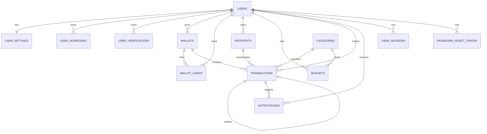

# Kaya Wallet 数据库设计

> 依据即时设计原型 23 个画板整理，默认数据库 **MySQL 8.0.16+**。
> DDL：`db/schema.sql`；基础分类种子：`db/seed.sql`。

## 1. 原型与数据表映射

| 原型画板 | 涉及数据表 |
| --- | --- |
| 引导页（Onboarding 1-3） | 无服务端数据，完成状态存客户端 localStorage |
| 登录 / 注册 / 忘记密码 | `users`、`user_sessions`、`password_reset_tokens` |
| 钱包首页（My Wallet） | `wallets`、`wallet_cards`、`transactions` |
| 转账 / 输入金额 / 转账成功 / 回执 | `transactions`、`recipients` |
| 消息通知 | `notifications` |
| 账户 / 编辑资料 | `users`、`user_settings`、`user_addresses`、`user_verifications` |
| 信用卡 | `wallet_cards` |
| 交易记录 / 预算提示 | `transactions`、`categories`、`budgets` |
| 记一笔收入 / 支出 | `transactions`、`categories` |

原型中的余额、本月收入/支出、预算百分比、回执都是**派生数据**，不单独建表，统一从流水计算，避免冗余不一致。

## 2. 设计规范

### 2.1 命名与结构

- 表名、字段名全部 `snake_case`，表名用复数（`users`、`transactions`），避免与 MySQL 保留字冲突。
- 主键统一 `id BIGINT UNSIGNED AUTO_INCREMENT`；外键 `{表名单数}_id`。
- 布尔字段 `is_*`，时间字段 `*_at`，金额字段 `*_amount`，编码字段 `*_code`。
- 索引前缀：唯一索引 `uk_`、普通索引 `idx_`、外键 `fk_`、检查约束 `chk_`。
- 每张表、每个字段必须有 `COMMENT`。

### 2.2 数据类型

- 金额统一 `DECIMAL(18,2)`，**禁止 FLOAT/DOUBLE**；币种 `CHAR(3)`（ISO 4217）。
- 时间统一 `DATETIME(3)`，数据库与时区无关，应用层按 UTC 存储、按用户时区展示。
- 状态/类型使用 `VARCHAR + CHECK`，不使用 `ENUM`，便于后续扩展枚举值。
- 字符串长度按业务上限设置，不使用无界 `TEXT`。

### 2.3 约束与索引

- 财务相关外键使用 `ON DELETE RESTRICT`，保留历史数据；仅会话、令牌等可级联删除。
- 交易对手名称、账号在流水中做**快照**，联系人被删除后历史回执仍完整。
- 高频查询按最左前缀建立组合索引，如 `(wallet_id, occurred_at DESC, id DESC)`。
- 软删除仅用于用户、地址、联系人、银行卡等主体数据；交易流水不可删除，用 `status` 处理失败/撤销。

### 2.4 安全

- 密码仅存 Argon2id/bcrypt 哈希；刷新令牌、重置令牌仅存 SHA-256 哈希。
- 银行卡禁止存完整卡号/CVV，只存支付网关 `payment_token`、卡号后四位、有效期。
- 实名证件号密文存储（应用层加密），额外保留后四位用于脱敏展示。

## 3. ER 图



## 4. 表说明

| 表 | 作用 | 关键约束 |
| --- | --- | --- |
| `users` | 账号、资料、登录状态 | `email`、`phone`、`username` 唯一；软删除 |
| `user_settings` | 语言、时区、默认币种、通知开关 | 与用户 1:1 |
| `user_addresses` | 收货/联系地址 | 按用户查询，默认地址应用层保证唯一 |
| `user_verifications` | 实名、地址、手机、邮箱认证 | `(user_id, type)` 唯一 |
| `wallets` | 用户钱包与余额 | `(user_id, currency_code)` 唯一；`balance >= 0` |
| `wallet_cards` | 借记卡/信用卡 | 只存 `payment_token` + `last4`，禁止明文卡号 |
| `categories` | 收支分类 | `code` 唯一；收入/支出分类型 |
| `budgets` | 分类月度预算 | `(user_id, category_id, period_start)` 唯一 |
| `recipients` | 转账联系人 | `(user_id, account_no)` 唯一（账号可为空） |
| `transactions` | 单边交易流水 | `reference_no`、`idempotency_key` 唯一 |
| `notifications` | 转账到账、预算提醒等 | 按 `(user_id, is_read, created_at)` 查询 |
| `user_sessions` | 登录刷新令牌 | 令牌哈希唯一 |
| `password_reset_tokens` | 找回密码令牌 | 令牌哈希唯一 |

### 4.1 交易流水的记账口径

一条 `transactions` 记录只影响一个钱包：

- `direction = 'credit'` 入账，`direction = 'debit'` 出账，`amount` 始终为正数。
- `type` 表业务类型：
  - `income` / `refund`：收入，`credit`，必须关联分类；
  - `expense`：支出，`debit`，必须关联分类；
  - `transfer_out`：转出，`debit`，金额记本金，手续费记 `fee_amount`；
  - `transfer_in`：转入，`credit`。
- 站内转账产生两条流水，通过 `related_transaction_id` 互相关联；跨行转账只产生转出方一条流水，对手信息写入快照字段。
- 钱包首页的「Send / Received / All」筛选映射为 `transfer_out / transfer_in / 全部类型`。

## 5. 核心流程

### 5.1 注册

同一事务内完成：

1. 写 `users`（密码哈希）。
2. 写 `user_settings`（默认币种 USD）。
3. 写 `wallets`（`currency_code = 'USD'`, `balance = 0`）。

唯一键冲突统一返回「邮箱/用户名已存在」。

### 5.2 记一笔支出

```sql
START TRANSACTION;

INSERT INTO transactions
  (reference_no, user_id, wallet_id, type, direction, status,
   amount, fee_amount, currency_code, category_id, note, occurred_at)
VALUES
  (?, ?, ?, 'expense', 'debit', 'success',
   ?, 0.00, 'USD', ?, ?, ?);

UPDATE wallets
SET balance = balance - ?, version = version + 1
WHERE id = ? AND balance >= ?;

COMMIT;
```

余额扣减与流水写入必须同事务；`balance >= ?` 同时充当余额校验。生产环境建议按 `version` 乐观锁重试或 `SELECT ... FOR UPDATE`。

### 5.3 转账（含 5% 手续费）

以原型 150.00 为例：本金 150.00，手续费 7.50，合计扣款 157.50。

1. 客户端生成 `idempotency_key`，唯一索引保证重复提交不会重复扣款。
2. 写 `transactions`：`type = 'transfer_out'`、`direction = 'debit'`、`amount = 150.00`、`fee_amount = 7.50`、`status = 'pending'`。
3. 扣减钱包余额 157.50，`recipients.last_used_at` 更新。
4. 支付/清算成功后置 `status = 'success'`，写 `notifications`；失败则置 `failed` 并回滚余额。
5. 回执页面直接按 `reference_no` 查询该流水，不单独建回执表。

### 5.4 本月收入 / 支出

```sql
SELECT
  COALESCE(SUM(CASE WHEN type = 'income'  THEN amount ELSE 0 END), 0) AS income,
  COALESCE(SUM(CASE WHEN type = 'expense' THEN amount + fee_amount ELSE 0 END), 0) AS spent
FROM transactions
WHERE user_id = ?
  AND status = 'success'
  AND occurred_at >= ? AND occurred_at < ?;
```

### 5.5 预算使用率与状态

预算只存额度，使用率实时聚合：

```sql
SELECT
  c.id,
  c.name,
  b.amount_limit,
  COALESCE(SUM(t.amount + t.fee_amount), 0) AS spent,
  ROUND(COALESCE(SUM(t.amount + t.fee_amount), 0) / b.amount_limit * 100, 2) AS used_percent
FROM budgets b
JOIN categories c ON c.id = b.category_id
LEFT JOIN transactions t
  ON t.user_id = b.user_id
 AND t.category_id = b.category_id
 AND t.type = 'expense'
 AND t.status = 'success'
 AND t.occurred_at >= b.period_start
 AND t.occurred_at < DATE_ADD(b.period_end, INTERVAL 1 DAY)
WHERE b.user_id = ?
  AND ? BETWEEN b.period_start AND b.period_end
GROUP BY c.id, c.name, b.amount_limit
ORDER BY used_percent DESC;
```

状态口径：`used_percent < alert_threshold(默认 80)` 为 under control；`80 ~ 100` 为 reach limit；`> 100` 为 over budget，与原型 60% / 90% / 110% 三档一致。

### 5.6 余额对账

`wallets.balance` 是缓存值，需定期与流水核对：

```sql
SELECT
  w.id,
  w.balance AS cached_balance,
  COALESCE(SUM(
    CASE
      WHEN t.status <> 'success' THEN 0
      WHEN t.direction = 'credit' THEN t.amount
      ELSE -(t.amount + t.fee_amount)
    END
  ), 0) AS ledger_balance
FROM wallets w
LEFT JOIN transactions t ON t.wallet_id = w.id
WHERE w.id = ?
GROUP BY w.id, w.balance;
```

> 对账前提：**所有余额变动都必须有流水**。新用户初始余额为 0；数据迁移、活动赠送、期初余额等场景也要写一条入账流水（如 `income` + 「其他收入」分类），否则缓存余额与流水必然不一致。

## 6. 关键取舍

- **单边流水而非复式记账**：当前原型只有个人钱包收支，单边流水 + 余额缓存足够，查询简单。若后续需要多账户清算、平台手续费账户、严格审计，再扩展 `ledger_accounts` / `ledger_entries` 复式账本，现有 `transactions` 可作为业务凭证保留。
- **分类为系统预置**：原型分类固定；后续需要用户自定义时，给 `categories` 增加 `user_id`，并将唯一键改为 `(user_id, type, name)`。
- **回执不落库**：回执所有字段可由 `transactions` + 对手快照还原；PDF 文件如需留档，后续增加 `receipt_files`。
- **引导页不落库**：完成标记放客户端；如需跨设备同步，再加 `user_onboarding_progress`。
- **汇率**：当前单币种 USD；多币种时新增 `exchange_rates`，并在流水中同时记录原币金额与结算金额。

## 7. 执行

```bash
# 1. 创建数据库（schema.sql 顶部有注释版本）
mysql -u root -p -e "CREATE DATABASE kaya DEFAULT CHARACTER SET utf8mb4 COLLATE utf8mb4_0900_ai_ci;"

# 2. 建表 + 基础分类
mysql -u root -p kaya < db/schema.sql
mysql -u root -p kaya < db/seed.sql
```
